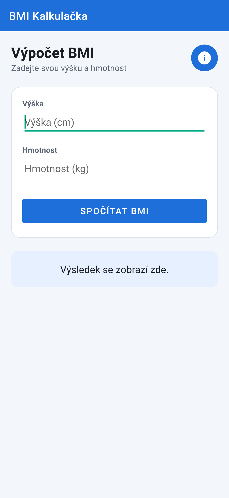
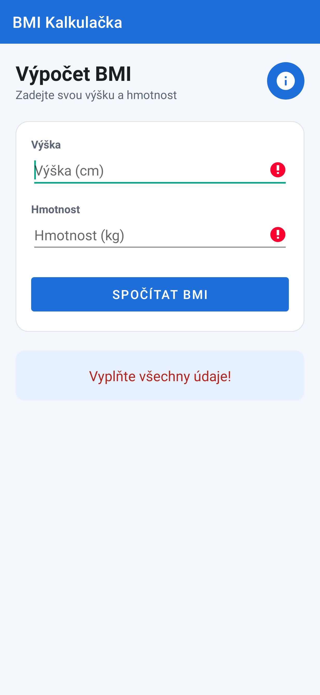
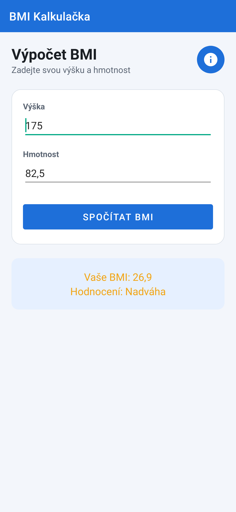
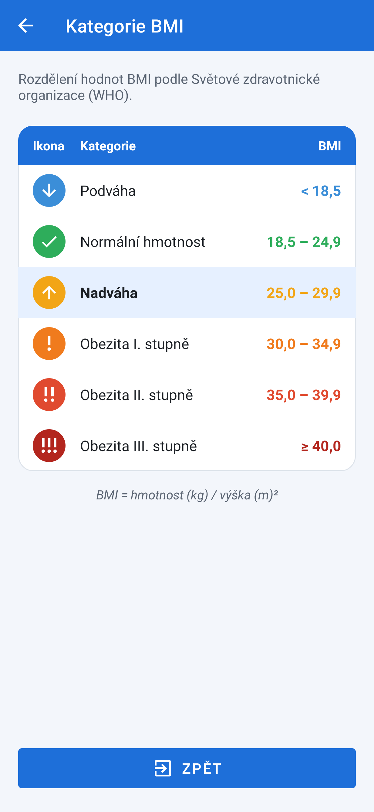

# BMI Kalkulačka – Android (Java)

Jednoduchá Android aplikace, která spočítá **index tělesné hmotnosti (BMI)** z výšky a hmotnosti
a na druhé obrazovce zobrazí přehled kategorií BMI v tabulce s ikonami.

| Hlavní obrazovka | Chybový vstup | Výsledek | Přehled kategorií |
|---|---|---|---|
|  |  |  |  |

## Spuštění

1. Otevřít složku projektu v **Android Studiu** (File → Open) a nechat proběhnout Gradle sync.
2. Spustit konfiguraci `app` na emulátoru nebo telefonu (minSdk 24 = Android 7.0).

Z příkazové řádky: `./gradlew assembleDebug` (APK v `app/build/outputs/apk/debug/`),
testy: `./gradlew testDebugUnitTest`.

## Struktura projektu

```
app/src/main/
├── AndroidManifest.xml                 – 2 aktivity (MainActivity, CategoriesActivity)
├── java/com/example/bmikalkulacka/
│   ├── MainActivity.java               – načtení vstupů, kontrola, převod, výpočet, výstup
│   ├── CategoriesActivity.java         – tabulka kategorií, tlačítko Zpět
│   └── BmiCalculator.java              – vzorec BMI a určení kategorie
└── res/
    ├── layout/activity_main.xml        – formulář (EditText ×2, Button, TextView, ImageButton)
    ├── layout/activity_categories.xml  – TableLayout + tlačítko Zpět
    ├── layout/item_category_row.xml    – jeden řádek tabulky (ikona, název, rozsah)
    ├── values/strings.xml              – všechny texty UI
    ├── values/arrays.xml               – seznamy hodnot: kategorie, rozsahy, ikony, barvy
    └── drawable/                       – vektorové ikony (info, odejít, ikony kategorií)
app/src/test/                           – jednotkové testy + smoke test UI (Robolectric)
```

## Splnění zadání (checklist)

| Kritérium | Kde / jak |
|---|---|
| **Správná definice prvků v XML (inputType, id)** | `activity_main.xml`: `etHeight` – `inputType="number"` (jen celá kladná čísla), `etWeight` – `inputType="numberDecimal"`, `btnCalculate` (Button), `tvResult` (TextView), `btnInfo` (ImageButton s ikonou informace). |
| **Všechny texty z `res/values/strings.xml`** | V layoutech ani v Javě není žádný napevno zapsaný text. Definováno mj. `hint_height`, `hint_weight`, `btn_calculate`, `error_empty`, `error_invalid`, parametrizovaný `bmi_result` (`%1$s` = BMI, `%2$s` = hodnocení). Názvy kategorií a rozsahy jsou v `arrays.xml` jako `string-array`. |
| **Načtení hodnot a ošetření prázdných vstupů** | `MainActivity.calculateBmi()` – `getText().toString().trim()`, při prázdném poli `setError(getString(R.string.error_empty))` u daného EditTextu + hláška v `tvResult`. |
| **Konverze typů a `NumberFormatException`** | `Double.parseDouble(...)` v bloku `try { } catch (NumberFormatException e)` → `error_invalid`. Navíc kontrola, že hodnota je > 0, a podpora desetinné čárky (`82,5`). |
| **Výpočet a zobrazení výsledku** | `BmiCalculator.calculate()` – `BMI = kg / (cm/100)²`. Výsledek: `getString(R.string.bmi_result, bmi, kategorie)`, zaokrouhleno na 1 desetinné místo, text obarven barvou kategorie. |
| **Bod 4 – více aktivit** | `ImageButton` (ikona *info*) otevře `CategoriesActivity` přes `Intent`. Tabulka (`TableLayout`) se plní ze **seznamů hodnot** v `arrays.xml` (`bmi_categories`, `bmi_ranges`, `bmi_icons`, `bmi_colors`), každá kategorie má vlastní barevnou ikonu. Kategorie naposledy spočítaného BMI je v tabulce zvýrazněna. Tlačítko **Zpět** se symbolem *odejít* (`ic_exit`) volá `finish()` a vrací na hlavní aktivitu (funguje i šipka v horní liště). |

## Kategorie BMI (WHO)

| Kategorie | BMI |
|---|---|
| Podváha | < 18,5 |
| Normální hmotnost | 18,5 – 24,9 |
| Nadváha | 25,0 – 29,9 |
| Obezita I. stupně | 30,0 – 34,9 |
| Obezita II. stupně | 35,0 – 39,9 |
| Obezita III. stupně | ≥ 40,0 |

## Testy

- `BmiCalculatorTest` – vzorec a hranice kategorií.
- `AppSmokeTest` (Robolectric) – inputType a texty z resources, prázdné vstupy, neplatné číslo,
  správný výsledek, desetinná čárka, mazání starých chyb, přechod na přehled kategorií
  (6 řádků tabulky) a návrat tlačítkem Zpět.
